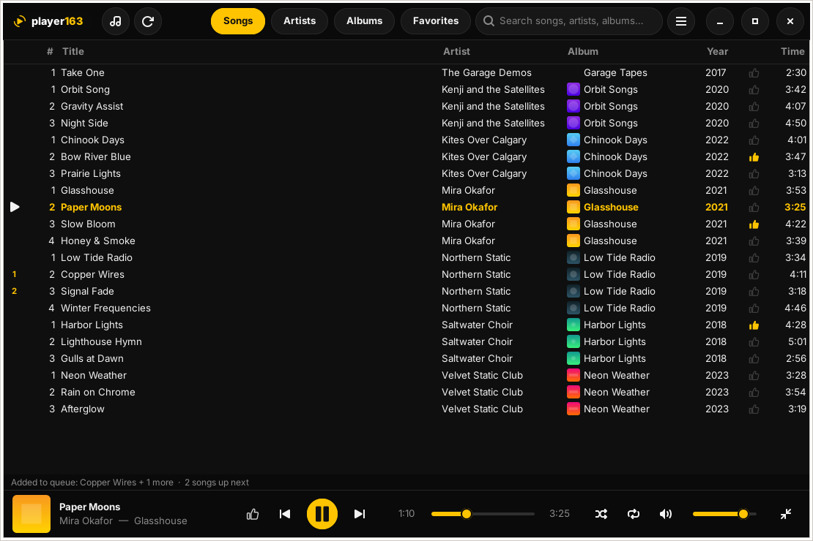
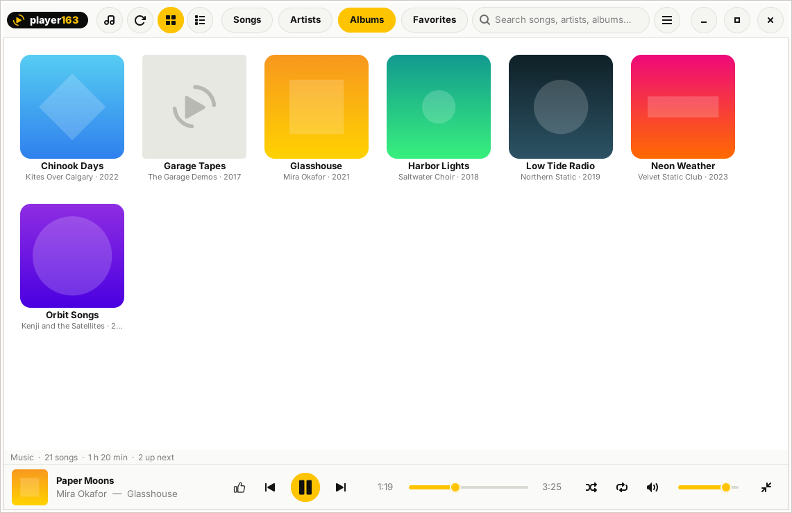
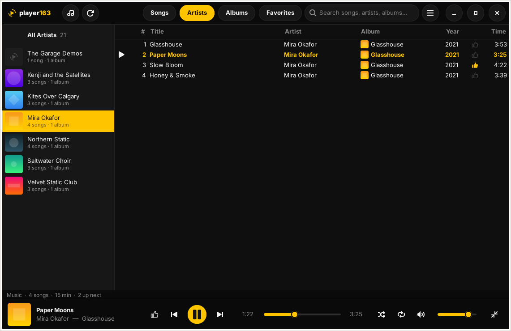
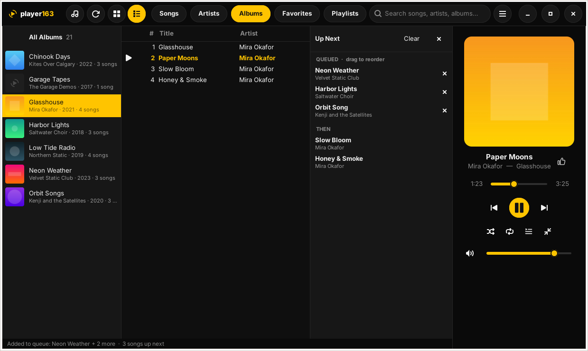
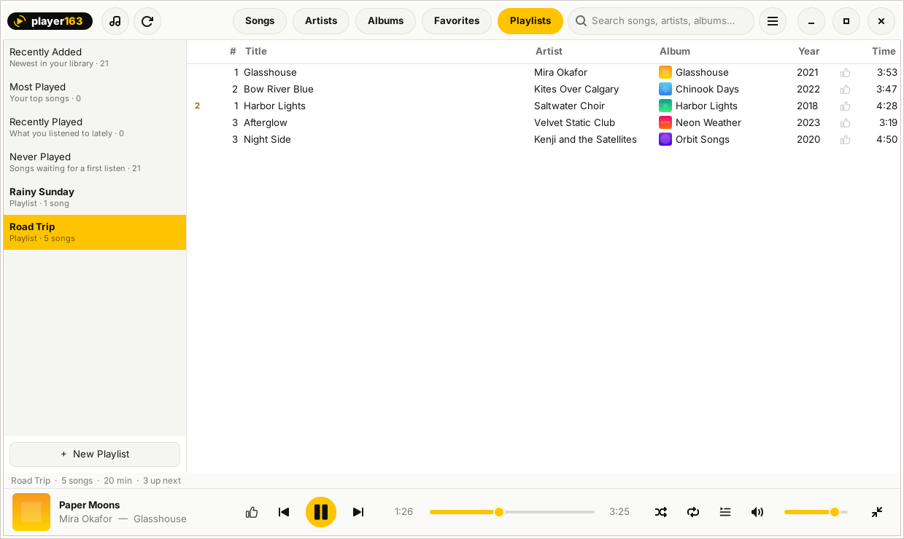
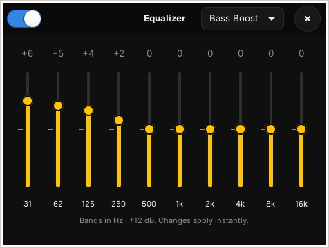
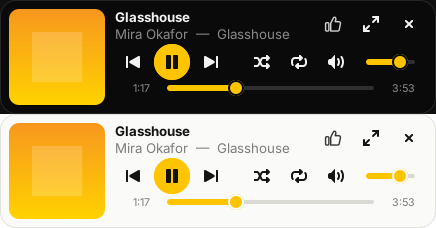
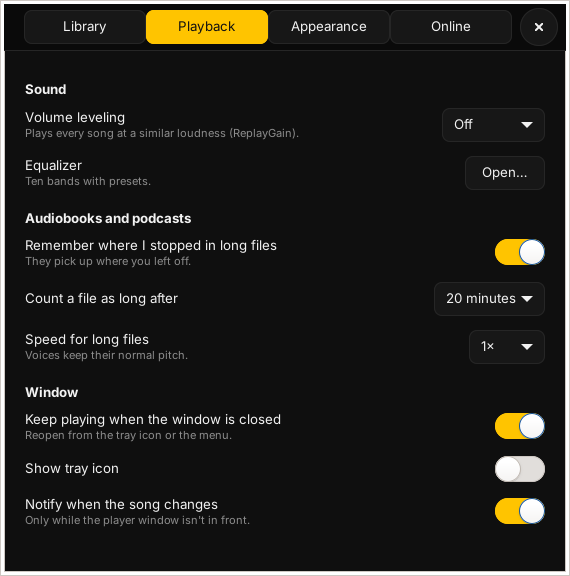

# player163

A small, no-fuss music player for Linux Mint (and Ubuntu / Debian).

| Album grid, light theme | Artists |
| --- | --- |
|  |  |

| Player on the side, with Up Next | Playlists, light theme |
| --- | --- |
|  |  |

| Equalizer | Mini player, dark and light | Preferences |
| --- | --- | --- |
|  |  |  |

## Install

**[Download the latest player163 (.deb)](https://github.com/samokish-ivan/player163/releases/latest/download/player163_latest_all.deb)**,
double-click it and choose **Install Package**.

Or download and install it from a terminal in one go:

    wget -O /tmp/player163.deb https://github.com/samokish-ivan/player163/releases/latest/download/player163_latest_all.deb && sudo apt install /tmp/player163.deb

Then start **player163** from the menu (Sound & Video), or run `player163`.

Requirements: Linux Mint 21 or newer, Ubuntu 22.04 or newer, or Debian 12 or newer. Everything
else (Python 3, GTK 3, GStreamer, mutagen) is installed automatically.

Uninstall: `sudo apt remove player163`

## Updates

Installing the .deb also adds the player163 update source
(https://samokish-ivan.github.io/player163), so new versions appear in Mint's **Update Manager**
like any other update. To turn this off, disable the source in
*Software Sources → Additional repositories*; reinstalling player163 keeps that choice.

## Use

1. On first start player163 uses your **Music** folder if it has music in it. Add more folders
   (another drive, a NAS…) with ☰ → *Add Music Folder…*, in **Preferences** (Ctrl+,), or just
   drop folders onto the window. Each folder is scanned once; after that only new or changed
   files are read, and new music shows up on its own within a few seconds.
2. Switch between **Songs / Artists / Albums / Favorites / Playlists** at the top. Just start typing to search.
   Albums can be shown as a list or a cover grid (buttons next to rescan).
3. Double-click (or Enter) to play. The queue is whatever list you're looking at.
4. Right-click songs (or an artist or album) for **Play Next** and **Add to Queue**. The **Up Next**
   panel (queue button in the player, or Ctrl+U) shows what's coming: drag to reorder, × to remove,
   double-click to play now.
5. Close the window while music plays and it keeps playing in the background. Bring it back from
   the tray icon or by opening player163 again; quit with **Ctrl+Q** or the tray menu.

### Playlists and smart lists

**Playlists** (Ctrl+5) has four automatic lists: *Recently Added*, *Most Played*, *Recently Played*
and *Never Played*, plus your own playlists. Right-click songs → *Add to Playlist*. In a playlist,
**Delete** removes songs and **Alt+↑ / Alt+↓** moves them. Right-click a playlist to rename, export
(.m3u) or delete it; *Import Playlist…* reads .m3u and .m3u8 files.

### Audiobooks and podcasts

Long files (over 20 minutes; you can change that) remember where you stopped and pick up there
next time. Right-click → *Play from Start* to start over. A speed button (1× → 1.25× → 1.5× …)
appears in the player for long files; voices keep their normal pitch.

### Album covers

Covers come from the files themselves or a `cover.jpg` / `folder.jpg` next to them. To set one,
**drop an image** on an album (in the grid, the Albums list, or the playing song's artwork), or
right-click an album → *Set Album Cover…*. The cover is written into the songs' files, and
**Ctrl+Z** undoes it.

Albums with no cover at all can be filled in from the internet: the first time you open Albums,
player163 asks. If you agree, album and artist **names** are looked up on MusicBrainz and the front
cover is downloaded from the Cover Art Archive. Downloaded covers are kept by player163 and don't
change your files. Right-click an album → *Find Cover Online* to try one album by hand.

### Artist pictures

Right-click an artist → **Set Artist Picture…** to use your own image. You can also let player163
find free photos: the first time you open Artists it asks, and you can change your mind in
Preferences → Online. You can also drop an image on an artist. When it's on, your artists' **names** (nothing else) are looked up
on MusicBrainz and Wikidata, and freely licensed photos are downloaded from Wikimedia Commons. Hover a
photo to see who took it and its license.

### Sound

- **Volume leveling** (☰ → Volume Leveling): evens out loud and quiet songs, per song or per album.
  It uses ReplayGain tags if your files have them and measures the rest in the background.
- **Equalizer** (☰ → Equalizer…): 10 bands with presets.

### Fixing tags (typos etc.)

- **Misspelled artist:** Artists view → right-click the bad name → *Rename Artist…* →
  type (or pick) the right name. All its songs are updated and merge into the correct artist.
- **Album name:** Albums view → right-click → *Rename Album…*
- **Anything else:** select one or many songs → right-click → *Edit Tags…* (or Ctrl+E / F2).
  With many songs selected, only the fields you change are written.

Tags are written to the files themselves, so other players see the fixes too.
Changed your mind? Click **Undo** in the bar that appears, or press **Ctrl+Z**.

## Favorites 👍

- Click the 👍 next to the song title (main window or mini player), or press **Ctrl+D**,
  to favorite the playing song. Click 👍 again to remove it.
- In any list, click the 👍 column to favorite a song, or right-click a selection →
  *Add to Favorites*.
- **Favorites** tab (Ctrl+4) is your playlist, newest first. Double-click to play it;
  shuffle/repeat work as usual.
- ☰ → *Export Favorites as Playlist…* saves an .m3u you can use in other players.
- Favorites survive rescans and are kept if you rename or move a file (matched by
  title, artist and album).

## Volume

The volume slider is player163's own slider in Mint's *Sound Settings → Applications*.
Moving one moves the other, and mute stays in sync. It doesn't change other apps;
your keyboard volume keys still control the overall system volume.

## Mini player

Click the mini-player button at the right end of the player bar (or press **Ctrl+M**) to shrink
to a tiny strip: album art, song, play controls, shuffle/repeat, volume and seek bar.

- Drag it anywhere by the art or background; it remembers where you put it.
- Back to the library: the ⤢ button, a double-click, or **Ctrl+M**.
- Right-click it for **Keep on Top**.
- If you quit while in mini mode, it opens in mini mode next time.

## Look

Black + yellow dark theme by default; switch to the light theme from the ☰ menu or Preferences.
In **Preferences → Appearance** you can also move the player controls from the bottom to a tall
panel on the **left or right** with big artwork, and make the text larger.
Brand assets (icon + wordmark lockup SVGs) are in `data/`.

## Formats

Anything GStreamer can decode: FLAC, ALAC (.m4a), MP3, AAC, Ogg Vorbis, Opus, WAV, AIFF,
APE, WavPack, WMA, Musepack, DSD (.dsf) and more. Playback is gapless.
For the rarer formats, also install: `sudo apt install gstreamer1.0-plugins-bad gstreamer1.0-plugins-ugly`

## Keys

| Key | Action |
|---|---|
| Space | Play / pause |
| Ctrl+→ / Ctrl+← | Next / previous |
| Ctrl+↑ / Ctrl+↓ | Volume |
| Ctrl+S / Ctrl+R | Shuffle / repeat (off → all → one) |
| Ctrl+1 / 2 / 3 / 4 / 5 | Songs / Artists / Albums / Favorites / Playlists |
| Esc | Clear search |
| Ctrl+E or F2 | Edit tags |
| Ctrl+D | Favorite the playing song |
| Ctrl+J | Jump to playing song |
| Ctrl+M | Mini player ⇄ library |
| Ctrl+Shift+E | Equalizer |
| Ctrl+U | Up Next panel |
| Ctrl+Z | Undo the last tag or cover change |
| Ctrl+, | Preferences |
| Ctrl+O / F5 | Add a music folder / rescan |
| Ctrl+Q | Quit (also stops background playback) |

Keyboard media keys and the Cinnamon sound applet work too (MPRIS).

## Files

- Settings: `~/.config/player163/config.json`
- Library cache: `~/.local/share/player163/library.db` (safe to delete; it rebuilds)
- Artist pictures: `~/.local/share/player163/artists/`
- Album covers set in player163 or downloaded: `~/.local/share/player163/covers/`

## Rebuild the .deb

    ./build-deb.sh

See CHANGELOG.md for version history, and RELEASING.md for how releases are published.

By Ivan Samokish — https://ivansamokish.com

Built with Python, GTK 3, GStreamer and mutagen. MIT licence.
